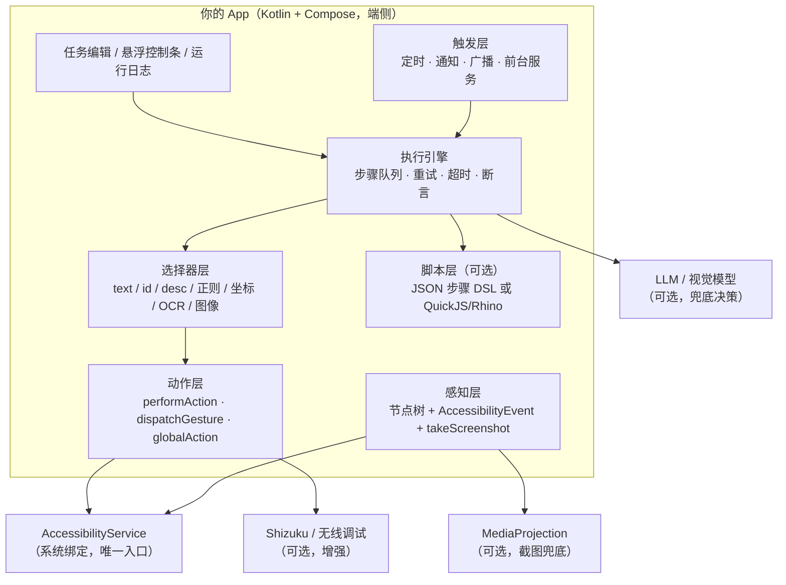

# 手机端「无障碍自动化」开源项目调研

> 调研时间：2026-11-19 · 数据来源：GitHub Search API + 各仓库 README/LICENSE 实读
> Stars 为当日快照，仅供量级参考。
> 目标场景：**手机 App 内用无障碍权限（AccessibilityService）控制手机操作，不依赖 PC / ADB**。

---

## 一、结论速览（TL;DR）

1. **这类项目非常多，而且 2026 年正在爆发**：从"脚本点按工具"演进到"端侧 AI Agent"，GitHub 上至少 30+ 个活跃仓库。
2. **纯无障碍能覆盖 80% 的"操作手机"需求**：读节点树、点击、长按、滑动、输入、返回/主页/通知栏、截图（Android 11+）。剩下 20%（shell 命令、强制停止、读私有数据、绕过 FLAG_SECURE）纯无障碍做不到，需要 Shizuku/root 或一次性无线调试。
3. **最贴近你构想的三个"整机方案"**：**GoBal（MIT，架构文档最完整）**、**opendroid（Apache-2.0，1.3k★）**、**Mika（Apache-2.0，9.1k★，但底子是无线调试 ADB 而非纯无障碍）**。
4. **最值得"抄代码/抄设计"的三个"零件"**：**GKD 的选择器与规则引擎**（45k★）、**AutoJs6 的脚本 API 分层**（6.7k★）、**assists / Android-Auto-Api 的无障碍封装**（注意 GPL 传染）。
5. **两个必须提前想清楚的非技术风险**：Android 13+ 对侧载 App 的「受限设置」会挡住无障碍开关；Google Play 对无障碍 API 的自动化用途审核极严，基本只能 GitHub/官网/F-Droid 分发。

---

## 二、全景对比表

### A 类：端侧 AI Agent（无障碍读屏 + 手势执行，手机自己跑）

| 项目 | ★ | 许可证 | 控制通道 | 要 ADB/PC？ | 亮点 / 可借鉴 |
|---|---|---|---|---|---|
| [4ward2/GoBal（狗宝）](https://github.com/4ward2/GoBal) | <10 | MIT | 无障碍 + MediaProjection 截图 + 可选端侧 llama.cpp | 不要 | **架构与你目标几乎重合**：任务树、成功即固化脚本、人工录制回放、文字/OCR/图像/屏幕签名多规则匹配、MCP 服务端、隐私保险箱（占位符脱敏）。缺点是项目很新、star 少，代码成熟度待验证 |
| [wangzan101/Mika](https://github.com/wangzan101/Mika) | 9.1k | Apache-2.0 | **无线调试（ADB over WiFi）+ 无障碍读屏 + 内置 OCR** | 需一次性配对，但**不需要 PC** | 首启引导做到了工业级；用 `settings put secure enabled_accessibility_services` 由 shell 帮自己打开无障碍，绕过「受限设置」；后台虚拟屏不占用你的前台界面 |
| [JMAN730/opendroid](https://github.com/JMAN730/opendroid) | 1.3k | Apache-2.0（附自定义声明） | 无障碍 + `takeScreenshot` + LiteRT 端侧小模型 | 不要 | 自规划/失败重规划、习惯挖掘、四层个人知识图谱；端侧模型下载与校验流程完整 |
| [Core-Mate/OpenGUI](https://github.com/Core-Mate/OpenGUI) | 1.8k | **BSL 1.1**（2030-04 前限制商用） | 无障碍 + 截图；桌面端走 ADB/scrcpy | 手机端不要，桌面端要 | "GUI Agent 框架 + 评测"的完整思路；**商用授权受限** |
| [Ayush0Chaudhary/blurr](https://github.com/Ayush0Chaudhary/blurr) | 995 | **仅个人/非商用** | 无障碍 + 云模型 | 不要 | 产品化交互值得看，**许可证禁止商用** |
| [niki914/zafiro](https://github.com/niki914/zafiro) | 380 | MIT | **Shizuku** + 原生 Shell/Python + Phone-Use | 需 Shizuku 启动（无线调试或 root） | 统一权限管理器（Root/Shizuku 自动授权）、工具封装思路 |
| [zephyr7030/DroidBridge](https://github.com/zephyr7030/DroidBridge) | 26 | Apache-2.0 | 无障碍 / Shizuku + **手机端 MCP server** | 不要 | 把手机变成「可被外部 Agent 调用」的服务端，含工具安全注解 |
| [ybblab/Droidance](https://github.com/ybblab/Droidance) | 179 | Apache-2.0 | **不用无障碍**：无线调试 + 后台虚拟屏 + 纯视觉 | 需一次配对 | 完全绕开无障碍的方案，可作对照 |
| [orailnoor/private-agent](https://github.com/orailnoor/private-agent) | 445 | 未标注 | Flutter + 无障碍 + DeepSeek | 不要 | 想做 Flutter 技术栈的话的参考 |
| [ManojDevarajulu/PocketAgent](https://github.com/ManojDevarajulu/PocketAgent) / [joungminsung/OpenPhoneUse](https://github.com/joungminsung/OpenPhoneUse) | 个位数~ | AGPL/MIT | 无障碍浮层 + 纯端侧 | 不要 | 更小、更"教学向"的完整实现 |

### B 类：脚本 / 规则引擎（最"纯"的无障碍自动化，非 AI）

| 项目 | ★ | 许可证 | 说明 | 可借鉴 |
|---|---|---|---|---|
| [gkd-kit/gkd](https://github.com/gkd-kit/gkd) | 45k | GPL-3.0 | 无障碍 + **高级选择器** + 订阅规则，专治开屏广告/乱七八糟弹窗 | **选择器语法设计是整个品类的教科书**；规则订阅分发模型；快照审查机制 |
| [clearw5/Auto.js](https://github.com/clearw5/Auto.js) | 12.9k | 未标注（已停更） | 品类开创者：无障碍 + Rhino JS 引擎 | 历史设计（`click()/text()/id()` 这套 API 已成都市传说） |
| [SuperMonster003/AutoJs6](https://github.com/SuperMonster003/AutoJs6) | 6.7k | MPL-2.0 | Auto.js 的活跃二开版；脚本 IDE、VS Code 插件、**可打包成独立 APK** | 脚本 API 分层、悬浮窗控制、打包流程；MPL 对文件级修改有传染性 |
| [aiselp/AutoX](https://github.com/aiselp/AutoX) | 2k | 未标注 | AutoX.js 分支，兼容老脚本生态 | 生态兼容策略 |
| [hamibot/hamibot](https://github.com/hamibot/hamibot) | 3.1k | 未标注 | 客户端开源 + 云端脚本市场/SaaS | 「本地执行 + 云端下发脚本」的商业模式 |
| [ven-coder/assists](https://github.com/ven-coder/assists) | 999 | **GPL-3.0** | 无障碍封装框架 + 生态（assists-mp 截图、assistsx-js 网页写脚本、Assists MCP） | **想快速搭架子直接读它**；但 GPL 传染，闭源商业项目别链 |
| [Krosxx/Android-Auto-Api](https://github.com/Krosxx/Android-Auto-Api) | 654 | **Apache-2.0** | Kotlin DSL 封装无障碍（`click { text = "登录" }` 风格） | **可商用**的轻量封装，适合当起点 |
| [DeekeScript](https://github.com/DeekeScript/deekeScript) | 19 | 未标注 | JSON 配置 UI + 无障碍的"可商业化"脚本框架 | 脚本 → UI 的配置化 |
| [LibreTap](https://github.com/Samo-samo/LibreTap) / [ld1856/AutoAction](https://github.com/ld1856/AutoAction) / SpeedClicker | 个位数 | 见仓库 | 无 root 连点器 + **录制回放**最小实现 | 录制回放的数据结构、坐标随机化反检测 |

### C 类：仍依赖 ADB / PC 的（对照，说明"为什么要脱离"）

| 项目 | ★ | 许可证 | 为什么不够 |
|---|---|---|---|
| [zai-org/Open-AutoGLM](https://github.com/zai-org/Open-AutoGLM) | 27k | Apache-2.0 | PC 经 ADB/HDC 控手机，手机侧无独立 App |
| [droidrun/droidrun](https://github.com/droidrun/droidrun) | 10k | MIT | ADB + Portal App，生态成熟但离不开电脑 |
| [X-PLUG/MobileAgent](https://github.com/X-PLUG/MobileAgent) | 9.4k | MIT | 研究基线，测的是"模型能力"不是"产品形态" |
| [Appium](https://github.com/appium/appium) / [uiautomator2](https://github.com/openatx/uiautomator2) / [scrcpy](https://github.com/Genymobile/scrcpy) | 155k(scrcpy) | Apache-2.0 | 标准测试/投屏方案，全部走 ADB |

### D 类：特权通道（不是无障碍，但能补足那 20%）

| 项目 | ★ | 许可证 | 作用 |
|---|---|---|---|
| [RikkaApps/Shizuku](https://github.com/RikkaApps/Shizuku) | 34k | Apache-2.0 | 借「无线调试/root」起一个 `app_process`，让普通 App 间接拿到 shell 权限：`am`、`pm`、`input`、`screencap`、`settings` 全都能用 |

> 结论：**无障碍 + Shizuku 是互补关系**，不是二选一。纯无障碍做"看得见界面上的操作"，Shizuku 补"界面之外的系统动作"。

---

## 三、无障碍到底能做什么、不能做什么

### ✅ 能做（纯无障碍，无需任何额外权限）

| 能力 | 关键 API | 备注 |
|---|---|---|
| 读界面节点树 | `getRootInActiveWindow()`、`findAccessibilityNodeInfosByText/ViewId`、`AccessibilityEvent` 监听 | 拿到 text / contentDescription / viewId / bounds |
| 点击、长按、滚动、输入 | `performAction(ACTION_CLICK / LONG_CLICK / SCROLL_* / SET_TEXT)` | 语义级操作，最稳 |
| 任意坐标手势 | `dispatchGesture()`（API 24+） | 单击/长按/滑动/多指，可打到自绘 UI |
| 全局动作 | `performGlobalAction(GLOBAL_ACTION_BACK/HOME/RECENTS/NOTIFICATIONS/QUICK_SETTINGS/LOCK_SCREEN)` | 返回、回桌面、拉通知栏 |
| 截屏 | `takeScreenshot()`（**API 30 / Android 11+**） | 拿不到 `FLAG_SECURE` 窗口 |
| 拉起任意 App | 自己进程里 `startActivity` + `getLaunchIntentForPackage` | 不需要无障碍权限 |
| 文本输入 | `ACTION_SET_TEXT`，或自建输入法 / 剪贴板 | 部分输入框 `SET_TEXT` 无效，要退回按键注入 |

### ❌ 做不到（必须换通道）

| 做不到 | 替代方案 |
|---|---|
| 执行 shell 命令（`am/pm/input/dumpsys`） | Shizuku / root / 一次性无线调试 |
| 截屏（Android 10 及以下） | `MediaProjection`（每次要授权 + 常驻通知） |
| 读取其他 App 私有数据、数据库、文件 | 无解（这是安全边界，不是权限问题） |
| 强制停止、清后台、改系统设置项 | Shizuku / root；或跳到设置页让用户自己点 |
| 绕过 `FLAG_SECURE`（银行、部分支付页） | 无解 |
| 游戏 / Flutter / Unity 自绘界面的"语义" | 只能盲点坐标 + OCR/视觉模型兜底 |

### ⚠️ 四个真实的工程坑（比 API 更容易翻车）

1. **Android 13+「受限设置」**：侧载的 APK，无障碍开关默认灰掉，必须去「应用信息 → ⋮ → 允许受限设置」放行；而且这个菜单项**要在你尝试打开一次、被系统拒绝之后才出现**。对策：检测到被拒时给用户精确的分步图文引导；或者走一次无线调试用 `settings put secure enabled_accessibility_services` 自己打开（Mika 的做法）。
2. **Google Play 政策**：Accessibility API 有专门条款，点击/自动化类应用审核极严、经常被拒或下架。现实分发渠道：GitHub Releases / 官网 APK / F-Droid。国内商店相对宽松但同样有审核风险。
3. **厂商杀后台**：小米/华为/OPPO/vivo 必须引导用户开「自启动 / 后台弹窗 / 电池不优化」，否则长任务跑一半就断。
4. **App 反自动化**：微信、支付宝、银行类 App 会检测无障碍服务列表并对自动化行为限流/锁功能；豆包手机就曾被多家 App 按 SAEP 协议拒绝。方案里要预留「敏感步骤交还用户」的降级路径（GoBal、Mika 都这么做）。

---

## 四、如果要自己写，推荐的分层架构

### 关键实现顺序（建议的 MVP 路线）

| 阶段 | 交付 | 验收标准 |
|---|---|---|
| W1 | AccessibilityService 骨架 + 节点树 dump 工具 + 悬浮窗 | 能在任意 App 里打印出可点击节点清单 |
| W2 | 选择器 + 动作执行（点击/滑动/输入/返回） | 手写 3 条脚本，能跑通"打开微信 → 搜索 → 发消息" |
| W3 | 录制回放（事件监听 → 步骤 JSON → 多规则匹配回放） | 录一遍能原样重放，界面改版后仍能命中 |
| W4 | 触发与调度（定时/通知/前台服务）+ 失败重试 | 息屏/切后台 30 分钟后任务仍能继续 |
| W5（可选） | LLM/视觉兜底 + 外部 MCP 接口 | 选择器全 miss 时，由模型看图决定点哪 |

### 可以直接复用的"零件"

- **选择器设计** → 抄 GKD 的 `text/desc/id + 正则 + 关系选择器`，比 XPath 好用得多。
- **无障碍封装** → [`Android-Auto-Api`](https://github.com/Krosxx/Android-Auto-Api)（Apache-2.0，可商用）或 [`assists`](https://github.com/ven-coder/assists)（GPL-3.0，仅参考设计）。
- **脚本层** → 参考 AutoJs6 的 API 命名（`click/text/id/waitFor`），但引擎用 QuickJS 更轻。
- **录制回放** → 参考 LibreTap / AutoAction 的步骤数据结构。
- **端侧 Agent 编排** → 参考 GoBal 的「任务树 + 成功即固化脚本」和 Mika 的首启引导脚本。
- **权限自愈** → 参考 Mika：用一次无线调试从 shell 侧打开无障碍（需要接受"一次配对"这个前提）。

### 许可证红线（如果打算商用/闭源）

| 可以商用 | 需谨慎 | 不能商用 |
|---|---|---|
| MIT：GoBal、zafiro、droidrun、MobileAgent | MPL-2.0：AutoJs6（改了的文件要开源） | **BSL 1.1**：OpenGUI（2030 前限制） |
| Apache-2.0：Mika、opendroid、DroidBridge、Android-Auto-Api、Shizuku、Open-AutoGLM | **GPL-3.0**：GKD、assists（链接即传染） | **个人使用许可**：blurr |

---

## 五、给你的三条判断

1. **"纯无障碍"是可行的，但别把它当教条**。如果你的目标是"稳定可控"，建议做成**无障碍为主 + 可选增强**：默认只申请无障碍 + 悬浮窗，跑得通；用户愿意再做一次无线调试配对，就解锁 Shizuku 增强（截图更快、能 `am start`、能精确输入）。
2. **产品形态决定技术选型**：
   - 做「自动化脚本工具」（用户自己编排） → 抄 AutoJs6/GKD 的路子，重在选择器与录制回放，不需要 LLM。
   - 做「说一句话就办完」 → 抄 GoBal 的路子，重在任务树、失败恢复、脚本固化，需要一个 LLM（端侧或 BYOK）。
3. **别一上来做通用 Agent**。这个赛道 2026 年已经很挤（Mika 9k★、Open-AutoGLM 27k★），垂直场景（比如"自动打卡/自动签到/客服自动回复/测试回放"）反而更容易做出差异。

---

## 附：检索关键词（自己继续挖时用）

`accessibilityservice` · `android-accessibility` · `android automation` · `gui-agent` · `phone-use` · `mobile-agent` · `无障碍 自动化` · `免root 自动化` · `auto.js` · `autojs` · `shizuku`
